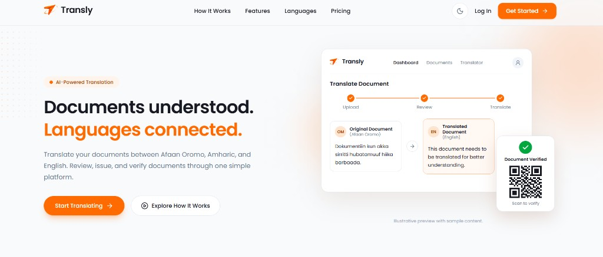

# Transly.

**Document translation between Afaan Oromo, Amharic, and English — extract, review, issue, and verify.**

<p align="center">
  
</p>

<p align="center">
  Translate official-style documents, issue a PDF with a verification QR, and check whether a certificate is valid, revoked, or not found.
</p>

Transly is an independent project (not a government service). Brand: **Orange & Midnight** (`#FF6B00` / `#171923`).

The running demo uses a **mock frontend** (`VITE_USE_MOCKS=true`). Login, documents, extract/translate, PDF/QR issuance, and public verify all work in the browser with localStorage. A real API and SQL live in `server/` for later integration — they are **not** used until mocks are turned off and Supabase is configured.

---

## Project overview

People in Ethiopia often need a document moved between **Afaan Oromo**, **Amharic**, and **English** — certificates, IDs, legal papers — without losing structure or a way to check authenticity.

Transly walks a customer through:

1. Upload a PDF or image  
2. Extract text into editable blocks  
3. Translate those blocks  
4. Optionally send them to a human translator  
5. Issue an A4 PDF with a QR code  
6. Let anyone open `/v/:id` and see **valid**, **revoked**, or **not found**

---

## Project preview


The landing page above is the live React UI: marketing copy, language pair preview, and entry points into login and the document workflow.

---

## Key features

What is actually in this repository today:

| Area | What you can do |
| --- | --- |
| Public site | Landing, pricing in ETB, public verification at `/v/:id` |
| Accounts | Register and log in. Mock mode accepts any credentials. An email containing `translator` gets the translator role. |
| Plans | Free vs paid catalog (Pro, Premium, Team, Enterprise). Paid checkout records `pending_payment` only — **nothing is charged**, and paid access is **not** activated. |
| Documents | Upload PDF / JPG / PNG (up to 10 MB). Choose source, target, and type (`academic`, `id_certificate`, `legal`, `other`). |
| Extract & translate | Review extracted blocks, edit, then machine-translate. Stamps, signatures, and logos stay placeholders. |
| Human review | Owner can send a document to `/translator`. Translators edit and may issue as human-reviewed. |
| Issue | Client-side PDF (pdf-lib, Noto Ethiopic) plus QR. Reserve → complete flow matches `shared/contract.ts`. |
| Verify / revoke | Public valid / revoked / not found. Owner can revoke an issued record. |
| Accessibility | First-visit Standard vs Accessible mode, larger text, high contrast, page reading, and **Listen to Document** (browser Web Speech API). |
| Theme | Light and dark (Orange & Midnight). |

There are **no** Profile or Settings pages.

---

## Supported languages

| Code | Language | Native |
| --- | --- | --- |
| `om` | Afaan Oromo | Afaan Oromoo |
| `am` | Amharic | አማርኛ |
| `en` | English | English |

Translation is between these three only, in any direction (source and target must differ).

---

## How it works

Document status in the contract: `uploaded` → `extracted` → `translated` → `in_review` → `reviewed` → `issued`.  
`revoked` is a **verify result** on an issued record, not a document status.

```text
Upload  →  Extract  →  Translate  →  Review (optional)  →  Issue  →  Verify
```

1. **Upload** — Store a file and create a document (`status: uploaded`).
2. **Extract** — Turn the file into typed blocks (heading, paragraph, table row, list item, stamp, signature, logo, handwriting).
3. **Translate** — Same block ids, order, count, and types; only `text` changes.
4. **Review** — Owner edits, or sends the document to a translator (`in_review`). The UI currently issues from review without a separate `reviewed` step.
5. **Issue** — Reserve a verification id, build the PDF and QR in the browser, then complete. SHA-256 is stored on complete.
6. **Verify** — Anyone with the id opens `/v/:id`. Mock demo ids: `revoked-demo` (revoked), `missing-demo` (not found). A document you issued in this browser is **valid** until revoked.

---

## Technology stack

Verified from `package.json` files in this repo:

| Layer | Stack |
| --- | --- |
| Frontend | React 19, Vite 7, React Router 7, Tailwind CSS 4, Lucide |
| PDF / QR | pdf-lib, @pdf-lib/fontkit, qrcode |
| Auth client | @supabase/supabase-js (used when mocks are off) |
| API | Vercel Node handlers, local `tsx` server |
| AI (API path) | @google/genai (Gemini) — not called while the UI is in mock mode |
| Contract | TypeScript types in `shared/contract.ts` (v2) |
| Speech | Native Web Speech API (`speechSynthesis`) — no paid TTS |

---

## Project structure

```text
transly/
├── client/                 React + Vite app (port 5173)
│   ├── src/pages/          Routes and screens
│   ├── src/services/       api.ts → mockApi or realApi
│   └── public/fonts/       Noto Sans / Noto Sans Ethiopic for issued PDFs
├── server/                 Local API (port 3000) and SQL
│   ├── api/                extract, translate, review, issue, verify
│   └── supabase/migrations 001_init, 002_constraints_and_updates, 003_grants
├── shared/contract.ts      Shared request/response types (lead-owned)
├── docs/                   Product and architecture notes
│   └── assets/             README preview image
├── vercel.json             Frontend build + API function timeouts
└── package.json            Root scripts: dev:client, dev:api, typecheck
```

---

## Getting started

**Prerequisites**

- Node.js (Vite 7 needs a current LTS; 20+ is a safe choice)
- npm

**Install**

```bash
git clone https://github.com/bekamtilahun7-prog/Transly.git
cd Transly

npm install --prefix client
npm install --prefix server
```

Copy env templates (do not commit filled `.env` files):

```bash
cp client/.env.example client/.env
cp server/.env.example server/.env
```

For the UI demo, set in `client/.env`:

```env
VITE_USE_MOCKS=true
```

You can leave `VITE_SUPABASE_URL` and `VITE_SUPABASE_ANON_KEY` empty while mocks are on.

---

## Environment configuration

Names only — never put service-role or Gemini keys in any `VITE_` variable.

**`client/.env` (browser-safe)**

| Variable | Purpose |
| --- | --- |
| `VITE_SUPABASE_URL` | Supabase project URL when mocks are off |
| `VITE_SUPABASE_ANON_KEY` | Anon key only — not the service role |
| `VITE_USE_MOCKS` | `true` = localStorage mock API and mock login |

**`server/.env` (API process, gitignored)**

| Variable | Purpose |
| --- | --- |
| `SUPABASE_URL` | Same project as the client, when using the real API |
| `SUPABASE_SERVICE_ROLE_KEY` | Server-side only |
| `GEMINI_API_KEY` | Gemini, when not mocking extract/translate |
| `GEMINI_MODEL` | Primary model name |
| `GEMINI_FALLBACK_MODEL` | Optional fallback |
| `GEMINI_MOCK` | `true` skips live Gemini in the API |
| `PARTNER_API_KEY_DEMO` | Optional; partner verify is 401/500 without it |
| `PORT` | Local API port (default `3000`) |

Restart Vite after changing any `VITE_*` value.

---

## Running locally

From the **repo root**, two processes:

```bash
# API — http://localhost:3000
npm run dev:api

# Frontend — http://localhost:5173
npm run dev:client
```

`npm run dev:web` is the same as `npm run dev:client`.  
From `client/`: `npm run dev` (Vite, **strictPort 5173**, proxies `/api` → `3000`).

Other scripts:

| Where | Command | What it does |
| --- | --- | --- |
| Root | `npm run typecheck` | Server + client TypeScript |
| `client/` | `npm run build` | Typecheck then Vite production build |
| `client/` | `npm run lint` | ESLint |
| `client/` | `npm run preview` | Preview the production build |
| `server/` | `npm run gemini:test` | Gemini helper script (needs `server/.env`) |

Open **http://localhost:5173**. With mocks on, the API process is optional.

**Mock login**

- Any email and password  
- Email containing `translator` → translator workspace at `/translator`

---

## Application routes

From `client/src/App.jsx`:

| Path | Who | Purpose |
| --- | --- | --- |
| `/` | Public | Landing |
| `/pricing` | Public | Plan catalog (ETB) |
| `/login` | Public | Sign in |
| `/register` | Public | Create an account |
| `/v/:id` | Public | Certificate check |
| `/onboarding` | Signed in | Plan picker (translators skip) |
| `/checkout` | Signed in | Amount due; Pay is disabled |
| `/dashboard` | Signed in + plan chosen | Home for documents |
| `/documents` | Same | Document list |
| `/documents/upload` | Same | Upload |
| `/documents/:id/review` | Same | Extraction review |
| `/documents/:id/translation` | Same | Translation review / issue / send for review |
| `/documents/issued/:verificationId` | Same | Issued PDF, download, revoke |
| `/translator` | Translator role | Review queue |
| `/translator/:id` | Translator role | Review and issue |
| `*` | Public | 404 |

---

## Demo mode

The current `client/.env` demo path is **`VITE_USE_MOCKS=true`**.

`client/src/services/api.ts` then uses `mockApi` instead of Supabase and `/api/*`.

| Behaviour | Detail |
| --- | --- |
| Persistence | `localStorage` (`transly.mock.db.v2`) |
| Auth | Any password; session in `transly.mock.user` |
| Seeds | Sample documents at uploaded / extracted / translated / in_review |
| Extract / translate | Sample Amharic or English blocks; translation prefixes `[MOCK]` |
| Verify | Real issued ids; `revoked-demo`; `missing-demo` |
| Free cap | Mock still blocks a 4th countable upload (403) |
| Speech | Page reader and document reader use the browser only |

To point the UI at the real API later: fill the two `VITE_SUPABASE_*` values, set `VITE_USE_MOCKS=false`, run SQL `001` → `002` → `003` in the Supabase SQL editor (`002` is required), confirm the private Storage bucket `documents`, and run `npm run dev:api` with `server/.env`.

---

## Project status

| Piece | Status |
| --- | --- |
| React UI and routing | Implemented |
| Mock login and full document demo | Implemented (this is the default run path) |
| Client PDF + QR | Implemented |
| Public verify screens | Implemented |
| Accessibility mode + document TTS | Implemented (browser speech) |
| `server/api` handlers | Present in the repo; unused while mocks are on |
| SQL migrations | Present; apply in Supabase before real API use |
| `shared/contract.ts` | v2, in use |
| Live Gemini through handlers | Not the default (`GEMINI_MOCK` is intended for API tests) |
| Payments / paid plan activation | Not implemented |
| Organizations, seats, invitations | Pricing copy only |

---

## Limitations

- **No payment provider.** Checkout never charges. Paid plans stay `pending_payment`. The UI does not treat them as active.
- **Mocks are the default.** Empty `VITE_SUPABASE_URL` / anon key is expected in demo mode.
- **SQL must be applied** on the live project before real extract/issue/verify. Without migration `002`, issue/verify can fail.
- **PDF is built in the browser.** The API hashes the bytes it is given; layout is not server-trusted.
- **Afaan Oromo extract/translate mocks** currently reuse Amharic or `[MOCK]`-prefixed text — language *selectors* include Oromo, but sample extract text is not a dedicated Oromo corpus.
- **Footer Privacy / Terms** are labels only (not pages).
- **Not a government verification system.** Partner verify (`GET /api/v1/verify/:id`) is a demo key path only.
- Speech quality depends on **voices installed in the browser**. Amharic and Afaan Oromo voices are often missing.

---

## Further reading

- [`docs/project.md`](docs/project.md) — product behaviour and API map  
- [`docs/architecture.md`](docs/architecture.md) — layout and ownership  
- [`docs/ai-handoff.md`](docs/ai-handoff.md) — notes for continuing work  

---

Transly is an independent project. It is not a government service.
